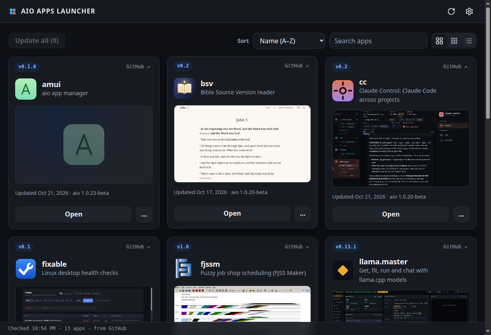

# AIO APPS LAUNCHER

Install, update and open [aio](https://github.com/riagentic/aio) desktop apps
from one window. Each app is cloned from git and built on your machine.



## Features

- 🧩 One card per app: icon, screenshot, version, aio version, last update
- ▶️ One button: **Install** → **Update to vX** → **Open**
- ⋯ Menu: Readme · Open · App / Profile directory · Reinstall · Uninstall ·
  GitHub
- 🔄 Hourly update check (`git ls-remote`), **Update all**
- 🔎 Search, sort, grid / compact / list views
- ⚙️ Settings: install folder, add / remove apps (any git repo, subfolder, extra
  repos, pre-build task)
- 🛎️ Tray icon — closing the window keeps it running
- ⬆️ Updates itself: a release build shows **Update launcher to vX** when a
  newer GitHub release is out (run from source: `git pull`)

## Apps

amui · ayd · bsv · calcaio · cc · fixable · fjssm · llama.master · machine ·
mdview · mushradar · netmap · protector · Space Invaders · spacy · writy

## Requirements

`git`, `deno` and [`am`](https://github.com/riagentic/aio) on `PATH` — the
launcher says which one is missing and how to get it:

- 🐧 Linux / 🍎 macOS:
  `curl -fsSL https://raw.githubusercontent.com/riagentic/aio/main/install.sh | sh`
- 🪟 Windows: `winget install Git.Git`, then
  `irm https://raw.githubusercontent.com/riagentic/aio/main/install.ps1 | iex`

Electron downloads once per machine (~100 MB, the launcher's first start); every
app shares it.

🍎 The macOS build is unsigned: right-click → **Open** the first time.

> ⚠️ Installing an app runs its repo's own build code. Add only repos you trust.

## Run

```sh
am fix                             # link the framework, install Electron
am start --client=electron         # or: deno task dev
deno task compile                  # AppImage → dist/
```

Apps go to `~/.aio-launcher/apps` (change it in Settings).

## Release

Push a tag `v<major.minor.commit-count>`: `.github/workflows/release.yml` builds
every platform on Linux and attaches the builds and their `<os>-<arch>.json`
manifests to the GitHub release — what a release build's updater reads.

## How an app is installed

1. `git clone --depth=1` (plus any extra repos beside it)
2. `am fix` (`--no-download` for an online app: it starts from the shared
   Electron)
3. `deno task <pre-build>` if set
4. `deno task build --targets=electron` → the Electron artifact in `dist/`

One install runs at a time; the others wait their turn.

Card info comes from the app's own files: `deno.json` (`version`, `aioVersion`),
its icon (`src/icon.svg|png`, `assets/icon.*`), and the first image in its
`README.md` (or `docs/screenshot.png`). Apps not yet installed are read from
GitHub.

## Develop

```sh
deno task check && deno task lint && deno task test
```

## License

[MIT](LICENSE)
